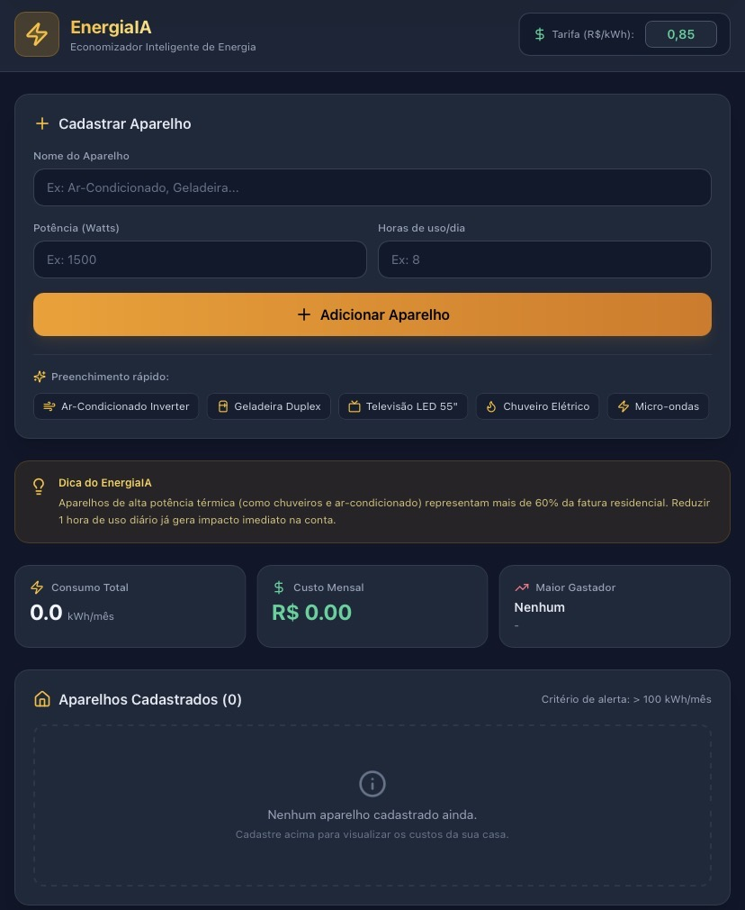

<p align="center">
  
</p>

EnergiaIA


# EnergiaIA

O **EnergiaIA** é uma aplicação web desenvolvida para monitorar, calcular e otimizar o consumo energético de eletrodomésticos. O sistema calcula a estimativa de consumo mensal em kilowatt-hora (kWh) e utiliza inteligência artificial para gerar recomendações personalizadas de eficiência energética, ajudando a reduzir custos e o impacto ambiental.

---

## 📌 Objetivo

Facilitar o controle do consumo elétrico residencial, permitindo que os usuários cadastrem seus aparelhos, vejam o custo estimado em reais (R$) e recebam dicas inteligentes da IA Gemini para economizar energia.

---

## 🚀 Funcionalidades Principais
- **Cálculo de Consumo:** Estimativa automática do consumo em kWh com base no tempo de utilização diária e potência dos equipamentos.
- **Recomendações com IA:** Análise de padrões e geração de dicas de economia de energia.
- **Interface Intuitiva:** Aplicação web interativa para gestão prática dos eletrodomésticos da casa.

---

## 🛠️ Construído com

- JavaScript
- React
- Gemini API

---

## 📂 Estrutura do Repositório

```text
energia-ia/
├── src/             # Componentes e lógica principal da aplicação
├── package.json     # Dependências e scripts do projeto
└── README.md        # Documentação do projeto
